<div align="center">




<br/><br/>

<!-- BADGE TECH -->
<a href="#-teknologi"></a>
<a href="#-teknologi"></a>
<a href="#-teknologi"></a>
<a href="#-teknologi"></a>
<a href="#-teknologi"></a>
<a href="#-teknologi"></a>
<a href="#-teknologi"></a>

<br/>

<!-- BADGE DATA -->


<br/>

<!-- CTA -->
<a href="https://wa.me/6281387685252?text=Halo%20Juana%20Motor!%20Saya%20mau%20tanya%20motor%20yang%20ada%20di%20katalog."></a>
<a href="https://www.google.com/maps/search/?api=1&query=-7.345583333,108.184025"></a>

<br/><br/>

**Juragan Motor Terlengkap Tasikmalaya, Jawa Barat — Indonesia**
**Pusat Jual Beli Motor Terbaik, Terlengkap dan Terpercaya Sejak Tahun 2020**

</div>


---

| | Navigasi README |
|:---:|:---:|
| [Ringkasan](#ringkasan) • [Statistik Katalog](#statistik-katalog) • [Fitur Website](#fitur-website) • [22 Merek](#22-merek-resmi) | [Teknologi](#teknologi) • [Menjalankan](#menjalankan) • [API](#api-rest) • [Kontak & Lokasi](#kontak--lokasi) |

---

<a id="ringkasan"></a>
## Ringkasan

**JUANA MOTOR TASIKMALAYA** adalah pusat jual beli motor terlengkap di Jawa Barat, khususnya Kota Tasikmalaya. Berdiri sejak **2020** di bawah bendera legal **Showroom Motor Mulya Juana Tasikmalaya** (pemilik: **Ujang Juana**), showroom ini mengelola **379 unit siap jual** — motor baru garansi resmi dan motor bekas pilihan yang sudah melalui inspeksi langsung oleh juragan.

Showroom berdiri di lahan seluas **280 m²** dengan bangunan **200 m²**, berlokasi strategis tepat di **pintu masuk Perum Griya Asri Mangkubumi Indah — Cipari**, Titik paling ramai di Koridor Jl. A.H. Nasution, Kota Tasikmalaya.

| Legalitas | Detail |
|---|---|
| Nama Badan Usaha | Showroom Motor Mulya Juana Tasikmalaya |
| Pemilik | Ujang Juana |
| NIB | 1006240019347 (terbit 10 Juni 2024) |
| KBLI | 47831 — Perdagangan Eceran Sepeda Motor Baru |
| Beroperasi Sejak | 2020 |
| WhatsApp | [+62 813-8768-5252](https://wa.me/6281387685252) |
| Email | prabudanling@gmail.com |

> Repository ini berisi **website showroom full animasi** (Next.js 16) lengkap dengan **database katalog master** hasil riset harga pasar November 2026, dibangun oleh [digiman.id](https://digiman.id).

---

<a id="statistik-katalog"></a>
## Statistik Katalog



### Rekap Per Kondisi

| Kondisi | Jumlah Unit | Rentang Harga | Keterangan |
|:---|:---:|:---|:---|
| **Motor Baru** | 170 unit | Rp 4.490.000 — Rp 439.900.000 | Garansi resmi, harga OTR price list riset Nov 2026 |
| **Motor Bekas Pilihan** | 209 unit | Rp 6.620.000 — Rp 105.480.000 | Sudah diinspeksi juragan, bisa kredit |
| **TOTAL SIAP JUAL** | **379 unit** | — | Semua ready stock |

### Rekap Per Kategori (9 Kategori)

| Kategori | Baru | Bekas | Total | Kategori | Baru | Bekas | Total |
|:---|:---:|:---:|:---:|:---|:---:|:---:|:---:|
| **Matic** | 43 | 74 | 117 | **Trail / ADV** | 19 | 15 | 34 |
| **Sport** | 21 | 27 | 48 | **Klasik / Retro** | 19 | 21 | 40 |
| **Naked** | 24 | 27 | 51 | **Elektrik** | 23 | 6 | 29 |
| **Bebek** | 9 | 24 | 33 | **Premium / Big Bike** | 11 | 15 | 26 |
| **Roda Tiga** | 1 | 0 | 1 | **TOTAL** | **170** | **209** | **379** |

Dari motor bebek harian sampai big bike premium, dari skutik listrik sampai trail adventure — **semua ada di satu showroom**.

---

<a id="fitur-website"></a>
## Fitur Website

Website showroom bergaya **racing dark theme** dengan animasi penuh (framer-motion + preloader sinematik) dan **8 halaman virtual** yang sudah lengkap:

| Halaman | Isi |
|:---|:---|
| **Beranda** | Hero animasi, unit unggulan, kategori, testimonial, CTA WhatsApp |
| **Katalog Lengkap** | 379 unit dengan pencarian realtime, filter kondisi/merek/kategori, slider harga, 5 mode sorting, foto produk tiap unit |
| **FAQ** | Pertanyaan yang sering diajukan seputar pembelian, kredit, dan tukar tambah |
| **Tentang Kami** | Profil juragan, sejarah sejak 2020, legalitas NIB, lokasi strategis |
| **Kontak** | WhatsApp, email, peta Google Maps interaktif, jam operasional |
| **Tips & Panduan** | Wawasan memilih motor baru/bekas dan tips perawatan |
| **Promo Terkini** | Penawaran spesial dan bundling kredit |
| **Syarat & Ketentuan** | Legal dan kebijakan transaksi |

### 3 Alat Bantu Interaktif

| Alat | Fungsi |
|:---|:---|
| **Jual Motor** | Form penawaran jual/ntonis ke showroom — langsung ke WhatsApp juragan |
| **Kalkulator Motor Bekas** | Estimasi harga bekas berbasis data penyusutan master (umur 1-10 tahun per kategori) |
| **Kalkulator Kredit** | Simulasi angsuran: DP, tenor, bunga flat/effective dari 7 partner leasing |

### Integrasi WhatsApp

Setiap unit di katalog punya tombol beli yang membuka chat WhatsApp ke **+62 813-8768-5252** dengan pesan otomatis berisi nama motor yang dipilih — tanpa ribet, langsung nego sama juragan.

---

<a id="22-merek-resmi"></a>
## 22 Merek Resmi

| Merek | Asal | Merek | Asal | Merek | Asal |
|:---|:---|:---|:---|:---|:---|
| Honda | Jepang | Yamaha | Jepang | Suzuki | Jepang |
| Kawasaki | Jepang | KTM | Austria | Bajaj | India |
| Benelli | Italia | Royal Enfield | India | Vespa | Italia |
| Piaggio | Italia | Aprilia | Italia | GPX | Thailand |
| Viar | Indonesia | Gesits | Indonesia | Alva | Indonesia |
| Volta | Indonesia | Uwinfly | Indonesia | United | Indonesia |
| Smoot | Indonesia | Polytron | Indonesia | Selis | Indonesia |
| Yadea | Tiongkok | | | | |

Merek lokal Indonesia (10 dari 22) didukung penuh — komitmen showroom pada ekosistem otomotif nasional.

---

<a id="teknologi"></a>
## Teknologi

| Layer | Teknologi | Peran |
|:---|:---|:---|
| Framework | Next.js 16 + React 19 | App Router, performa maksimal |
| Bahasa | TypeScript 5 | Type safety menyeluruh |
| Styling | Tailwind CSS v4 + shadcn/ui | Racing dark theme, komponen aksesibel |
| Animasi | framer-motion | Preloader, transisi halaman, micro-interaction |
| Database | Prisma 6 + SQLite | Katalog 379 unit, relasi inquiry |
| Router | Hash-based client routing | 8 halaman virtual dalam satu route |
| Runtime | Bun | Dev & production super cepat |

---

<a id="menjalankan"></a>
## Menjalankan

### Prasyarat

- Node.js 20+ atau [Bun](https://bun.sh) 1.1+
- Git

### Langkah Cepat

```bash
git clone https://github.com/gunaracorp/juana-motor.git
cd juana-motor

bun install            # atau: npm install

bunx prisma db push    # sinkronkan skema (opsional — db sudah tersedia)
bun scripts/seed.ts    # isi katalog 379 unit (opsional — db sudah ter-seed)

bun run dev            # buka http://localhost:3000
```

> Database SQLite (`db/custom.db`) sudah ikut di-repo dalam kondisi **ter-seed penuh 379 unit** — website langsung jalan tanpa langkah seed.

### Mode Production

```bash
bun run build
bun run start          # standalone server di port 3000
```

---

<a id="api-rest"></a>
## API REST

<details>
<summary><b>Lihat dokumentasi endpoint lengkap</b></summary>

### `GET /api/motorcycles`

Katalog lengkap dengan filter majemuk.

| Parameter | Tipe | Contoh | Keterangan |
|:---|:---|:---|:---|
| `condition` | string | `baru` / `bekas` | Filter kondisi |
| `brand` | string | `Honda` | Filter merek (22 merek) |
| `category` | string | `matic` | Filter kategori (9 kategori) |
| `q` | string | `nmax` | Pencarian nama/deskripsi/warna |
| `minPrice` | number | `15000000` | Harga minimum |
| `maxPrice` | number | `50000000` | Harga maksimum |
| `sort` | string | `harga-asc` | `featured` / `harga-asc` / `harga-desc` / `tahun` |

```bash
curl "http://localhost:3000/api/motorcycles?condition=baru&brand=Yamaha&sort=harga-asc"
```

```json
{
  "ok": true,
  "total": 12,
  "data": [
    { "name": "Yamaha NMAX 155 Connected", "brand": "Yamaha", "condition": "baru", "price": 33900000, "...": "..." }
  ]
}
```

### `POST /api/inquiries`

Kirim permintaan pembelian / penawaran tukar tambah (tersimpan ke database + notifikasi WhatsApp).

### `GET /api`

Health check API.

</details>

---

<a id="kontak--lokasi"></a>
## Kontak & Lokasi

<div align="center">

<a href="https://wa.me/6281387685252?text=Halo%20Juana%20Motor!%20Saya%20mau%20tanya%20motor%20yang%20ada%20di%20katalog."></a>

</div>

| | Alamat Showroom |
|---|:---|
| **Ruko** | Ruko Perumahan Griya Mangkubumi Indah No. 1 |
| **Jalan** | Jl. A.H. Nasution |
| **Kelurahan / Kecamatan** | Cipari / Mangkubumi |
| **Kota / Provinsi** | Kota Tasikmalaya / Jawa Barat |
| **Kode Pos** | 46181 |
| **Titik Landmark** | Pintu masuk Perum Griya Asri Mangkubumi Indah |
| **Koordinat** | `-7.345583333, 108.184025` — [Buka Google Maps](https://www.google.com/maps/search/?api=1&query=-7.345583333,108.184025) |

### Jam Operasional

| Hari | Jam |
|:---|:---|
| Senin — Jumat | 08.00 — 20.00 WIB |
| Sabtu — Minggu | 08.00 — 21.00 WIB |
| Hari Libur Nasional | 09.00 — 17.00 WIB |

---

## Struktur Repository

<details open>
<summary><b>Peta file project</b></summary>

```
juana-motor/
├── assets/readme/            # 7 aset SVG animasi kustom README ini
├── src/
│   ├── app/
│   │   ├── api/              # REST: motorcycles, inquiries
│   │   ├── layout.tsx        # Root layout + SEO meta
│   │   ├── page.tsx          # Entry point (hash router 8 halaman)
│   │   └── globals.css       # Racing dark theme (oklch)
│   ├── components/
│   │   ├── juana/            # hero, navbar, catalog, tools, pages, preloader...
│   │   └── ui/               # shadcn/ui lengkap
│   ├── config/
│   │   ├── site.ts           # Data brand, kontak, lokasi, merek, leasing
│   │   └── nav.ts            # Router 8 halaman virtual
│   ├── data/penyusutan.ts    # Master data kalkulator bekas
│   └── lib/db.ts             # Prisma client
├── prisma/schema.prisma      # Model Motorcycle + Inquiry
├── db/custom.db              # SQLite — 379 unit ter-seed siap pakai
├── scripts/
│   ├── seed.ts               # Seeder dari database master
│   └── seed-data.json        # 379 unit + harga riset Nov 2026
├── public/images/models/     # 102 foto produk motor
├── upload/                   # Dokumen sumber: Excel harga, NIB, lokasi, tata ruang
└── package.json
```

</details>

---

## Legal & Kredit

| | |
|---|:---|
| **Design by** | [digiman.id](https://digiman.id) — PT Digital Bisnis Manajemen |
| **Licensing by** | [PT Top Konsultan Internasional](https://topkonsultan.web.id) — topkonsultan.web.id |
| **Legalitas Showroom** | NIB 1006240019347 — KBLI 47831 — Showroom Motor Mulya Juana Tasikmalaya |

---

<div align="center">


### JUANA MOTOR TASIKMALAYA

**Juragan Motor Terlengkap Tasikmalaya, Jawa Barat — Indonesia**
Pusat Jual Beli Motor Terbaik, Terlengkap dan Terpercaya **Sejak Tahun 2020**

Ruko Griya Mangkubumi Indah No.1, Jl. A.H. Nasution, Cipari, Mangkubumi, Kota Tasikmalaya 46181

[WhatsApp +62 813-8768-5252](https://wa.me/6281387685252) — [Email](mailto:prabudanling@gmail.com) — [Google Maps](https://www.google.com/maps/search/?api=1&query=-7.345583333,108.184025)

<br/>

*Design by digiman.id — PT Digital Bisnis Manajemen • Licensing by PT Top Konsultan Internasional — topkonsultan.web.id*

</div>
